# DevMagic Panel - Local WordPress Control Panel


[](LICENSE)
[](#-requirements)
[](#-requirements)
[](https://wordpress.org)
[](https://webtimeless.cloud/docs/devmagic-panel/)

> 🚀 A modern, cPanel-like control panel for the WordPress sites on your own machine: open `https://local.devmagic`, log in, and manage certificates, Apache vhosts, `/etc/hosts`, WordPress cores and installs, in light or dark.

<div align="center">
  
</div>

DevMagic Panel grew out of the [devmagic](https://github.com/PetyoLazarov92/devmagic)
CLI: the same local setup (sites in `/var/www`, certificates from a local CA,
Apache vhosts), as pages and buttons instead of commands, and it works next to
the sites devmagic or you made by hand. It manages this machine only and
listens on localhost.

📚 This page is the short tour. Every detail is in the [docs](docs/README.md).

## 📋 Table of Contents

- [Features](#-features)
- [Screenshots](#-screenshots)
- [How it works](#-how-it-works)
- [Requirements](#-requirements)
- [Installation](#-installation)
- [Quick start](#-quick-start)
- [Pages](#-pages)
- [Living with your existing setup](#-living-with-your-existing-setup)
- [Install a project](#-install-a-project)
- [AI assistant](#-ai-assistant)
- [Undo and backups](#%EF%B8%8F-undo-and-backups)
- [Updates](#-updates)
- [Uninstall](#%EF%B8%8F-uninstall)
- [How it stays safe](#-how-it-stays-safe)
- [Troubleshooting](#-troubleshooting)
- [Develop](#-develop)
- [License](#-license)
- [Support development](#-support-development)
- [Changelog](#-changelog)

## ✨ Features

- ✅ **Sites at a glance**: health, certificate, core, git, database and logs for every site, made by the panel or by hand. [More](docs/sites.md)
- ✅ **New site wizard**: a project's repos, each in its own folder, with its dump from anywhere; or a fresh WordPress or empty site. [More](docs/new-site.md)
- ✅ **SSL from a local CA**: one certificate covers every domain of a site, trusted in the system, Chrome, Edge and Firefox. [More](docs/sites.md#domains-and-ssl)
- ✅ **Apache and hosts**: vhosts with the panel's marker and one marked block in `/etc/hosts`; what you made by hand stays. [More](docs/existing-setup.md)
- ✅ **nginx next to Apache**: each site on Apache, nginx in front of Apache, or nginx alone with its .htaccess rules translated, with Undo. [More](docs/services.md#nginx-servicesnginx)
- ✅ **Shared WordPress cores** through `wpcore`: add a release, switch sites to it, remove unused ones. [More](docs/pages.md#wp-cores)
- ✅ **Local mode**: mail goes to Mailpit, search engines are told not to index, logins work from this computer only. [More](docs/existing-setup.md#the-two-files-the-panel-adds-to-a-site)
- ✅ **One click**: wp-admin login, caches, rewrite rules, debug constants, `debug.log`, VS Code, branches and pull. [More](docs/sites.md#quick-actions)
- ✅ **Files**: browse, edit, upload, zip and find in a site's folder, with Undo for deletes, git changes and uploads from production. [More](docs/files.md)
- ✅ **Databases**: browse and edit rows, run SQL, clean up WordPress, snapshot, import and export, each change saved first for Undo. [More](docs/databases.md)
- ✅ **Import a database**: from production over SSH in one click, or any dump, as it is or cleaned of private data, with your old tables kept. [More](docs/databases.md#backups-and-tools)
- ✅ **Plugin and theme updates**: one or all at once from WordPress.org, a snapshot first, each folder kept for Undo. [More](docs/sites.md#plugins)
- ✅ **Performance**: a tab per site with Xdebug profiles by plugin and function, and the top queries of its database. [More](docs/sites.md#performance)
- ✅ **Command palette**: Ctrl+K jumps to any site or page and runs its quick actions. [More](docs/pages.md#command-palette)
- ✅ **Cron**: your crontab's tasks and each site's WP-Cron events, with history and Undo; only the panel's block is written. [More](docs/services.md#cron-servicescron)
- ✅ **Aura**: every problem on your sites and this machine in one list, with one-click fixes, Fix all and, when switched on, known plugin vulnerabilities. [More](docs/pages.md#aura)
- ✅ **Undo and removed sites**: removed or replaced sites are kept 14 days, installs can be undone, system files are backed up first. [More](docs/undo-and-backups.md)
- ✅ **Updates without a token**: through public HTTPS, the GitHub CLI or git over SSH, whichever reaches the repository. [More](docs/updates.md)
- ✅ **Optional AI assistant**: a briefing, a chat and an MCP server for Claude Code; every change comes back as a card you run. [More](docs/ai-assistant.md)
- ✅ **Light and dark themes**, a phone-friendly layout, localhost only

[⬆️ Back to top](#-table-of-contents)

## 📸 Screenshots

<picture>
  <source media="(prefers-color-scheme: dark)" srcset="assets/screenshots/sites-dark.png">
  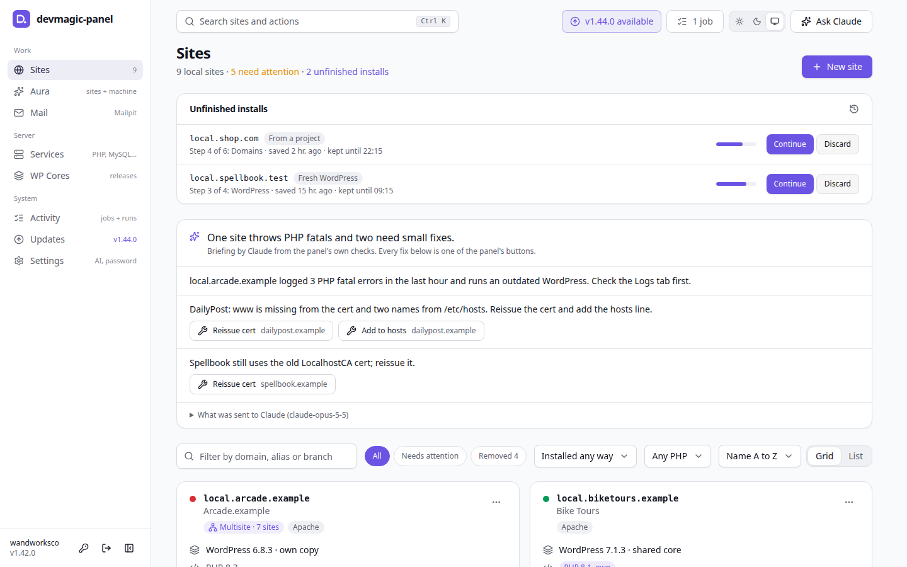
</picture>

<details>
<summary><b>More screenshots</b></summary>

**Aura**: every problem in one list, with its fix, and the machine checks behind it

<picture>
  <source media="(prefers-color-scheme: dark)" srcset="assets/screenshots/aura-dark.png">
  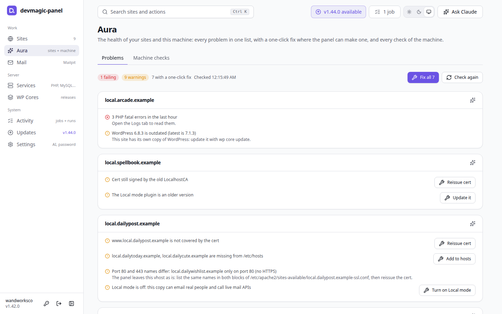
</picture>

**New site**: three ways to start, and unfinished installs to continue

<picture>
  <source media="(prefers-color-scheme: dark)" srcset="assets/screenshots/new-site-dark.png">
  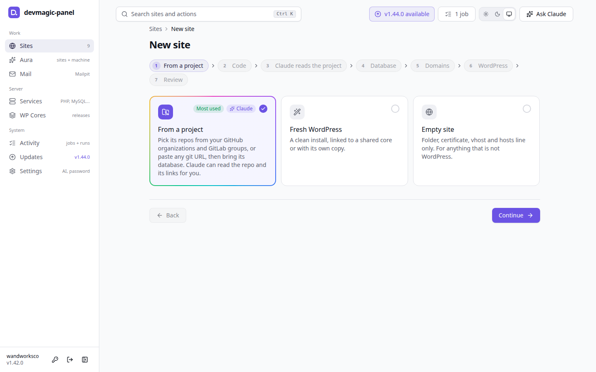
</picture>

**A site's server and PHP**: Apache, nginx + Apache or nginx, and a PHP version and settings of its own

<picture>
  <source media="(prefers-color-scheme: dark)" srcset="assets/screenshots/site-dark.png">
  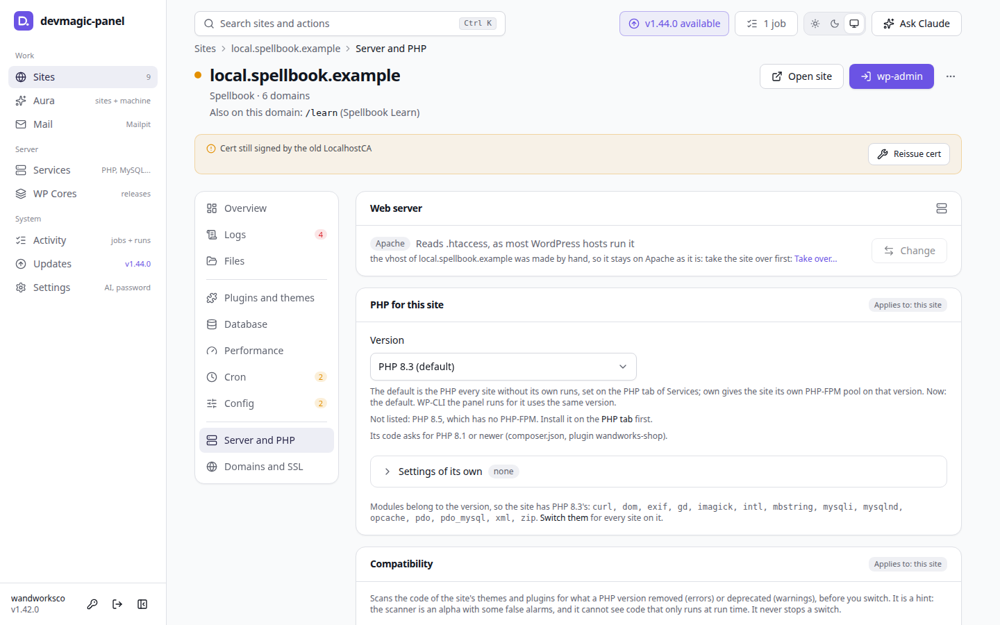
</picture>

**Files**: a site's folder with search, git status and diffs, an editor, uploads and a file trash kept 14 days

<picture>
  <source media="(prefers-color-scheme: dark)" srcset="assets/screenshots/files-dark.png">
  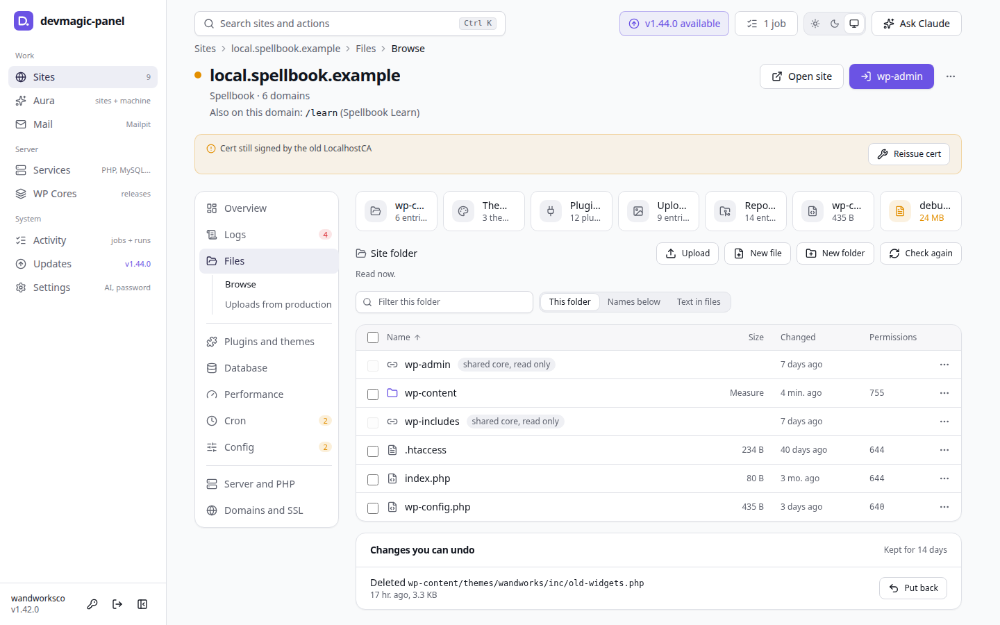
</picture>

**Database**: what needs a look in the WordPress view, with clean-ups and table health

<picture>
  <source media="(prefers-color-scheme: dark)" srcset="assets/screenshots/database-dark.png">
  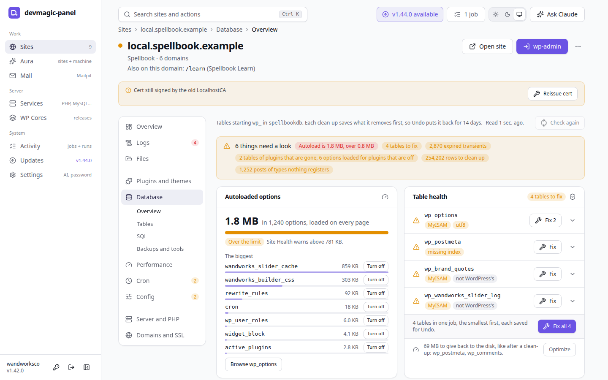
</picture>

**SQL runner**: read-only by default, with suggestions, Explain, history and CSV

<picture>
  <source media="(prefers-color-scheme: dark)" srcset="assets/screenshots/sql-dark.png">
  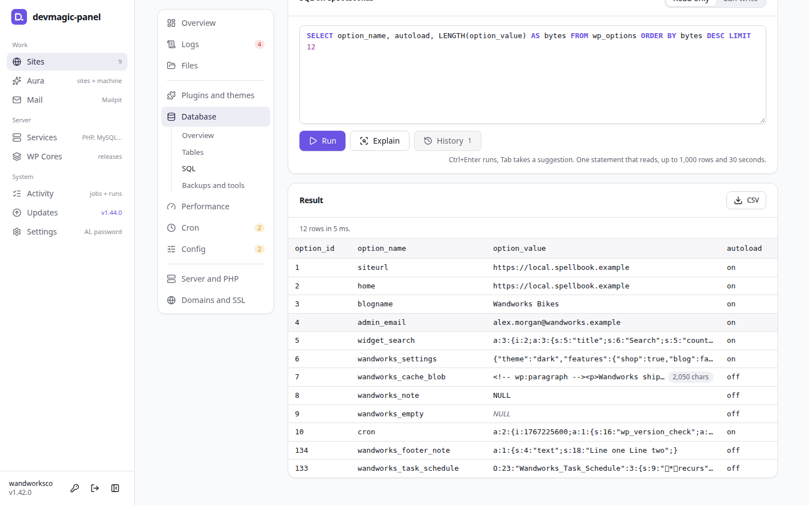
</picture>

**Import a database**: a copy from production over SSH or a dump, as it is or cleaned, with the old tables kept 7 days

<picture>
  <source media="(prefers-color-scheme: dark)" srcset="assets/screenshots/import-dark.png">
  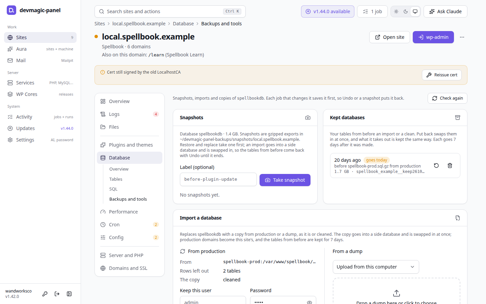
</picture>

**Performance**: Xdebug profiles with time per plugin, and slow queries

<picture>
  <source media="(prefers-color-scheme: dark)" srcset="assets/screenshots/performance-dark.png">
  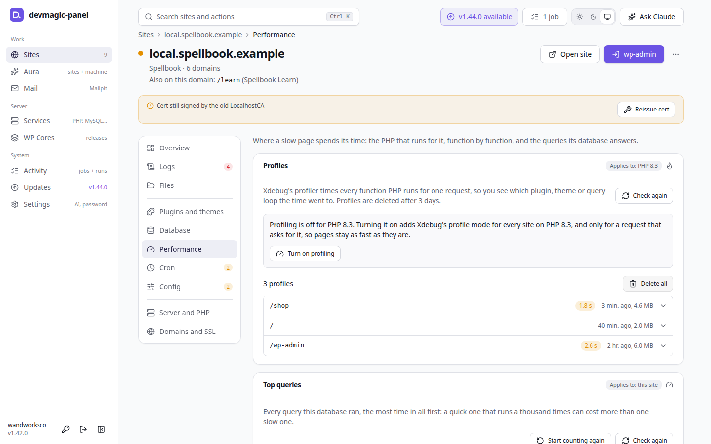
</picture>

**Command palette**: every page and quick action from the keyboard, with Ctrl+K

<picture>
  <source media="(prefers-color-scheme: dark)" srcset="assets/screenshots/palette-dark.png">
  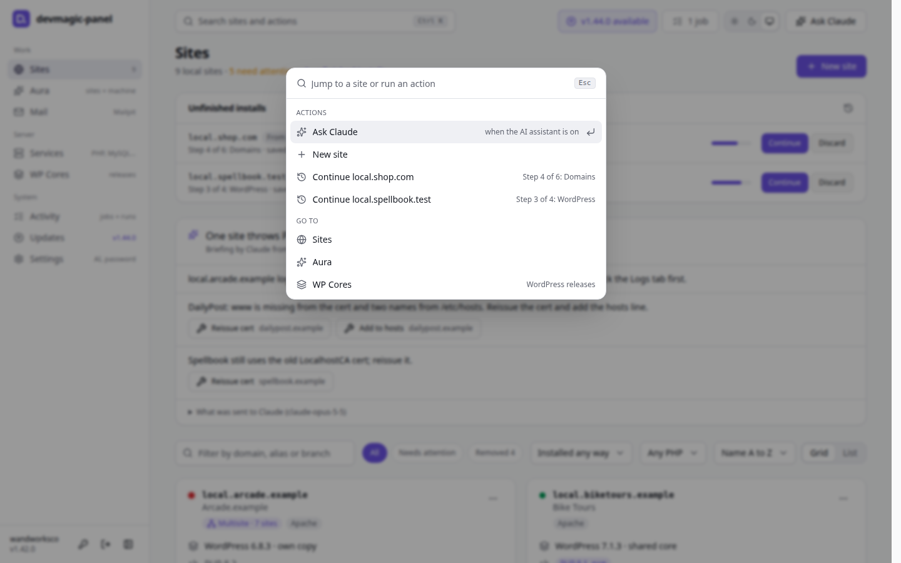
</picture>

**Activity**: the jobs running now and every action the panel ran

<picture>
  <source media="(prefers-color-scheme: dark)" srcset="assets/screenshots/activity-dark.png">
  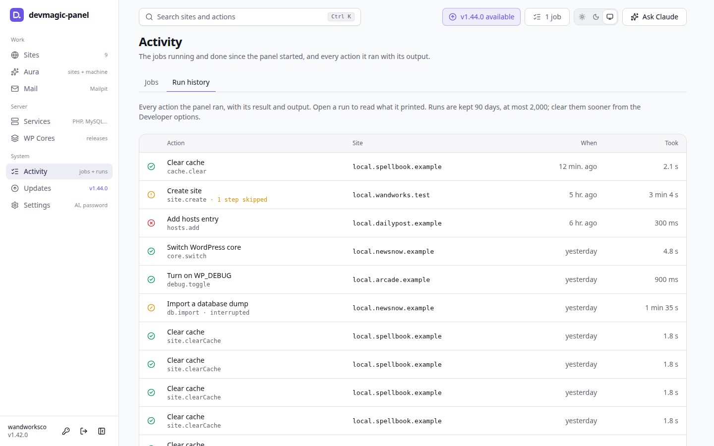
</picture>

</details>

The screenshots use the mockup's sample data: `npm run screenshots` takes them all again, in light and dark.

[⬆️ Back to top](#-table-of-contents)

## 🧭 How it works

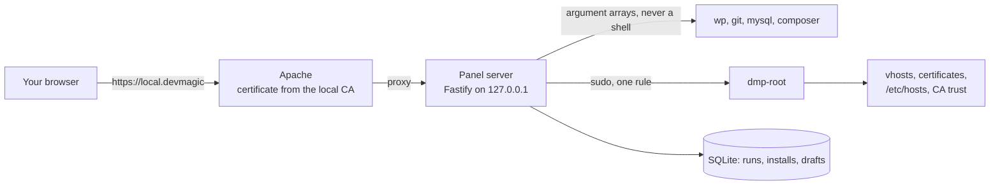

- **One server, one page.** A Fastify server on `127.0.0.1` serves the React
  UI and runs a fixed list of actions. Apache puts it at
  `https://local.devmagic` with a certificate from the panel's local CA.
- **Root through one door.** Everything that needs root goes through
  `dmp-root`, a root-owned script that validates every argument and reads its
  paths from `/etc/devmagic-panel/config.env`. The sudoers rule allows only it
  and `wpcore`.
- **The system is the source of truth.** Sites, aliases and certificates are
  read from the vhosts, `/etc/hosts` and the certificate folder; the panel's
  own database keeps only what the system cannot tell, like how a site was
  installed and the wizard's answers per repo.
- **Jobs you can follow.** Installs, imports and updates run as jobs with
  steps, progress and output. A failed job can be retried from its step, and
  most can be undone.

[⬆️ Back to top](#-table-of-contents)

## 📦 Requirements

Ubuntu or Debian (Mint works), sudo rights and curl. The installer checks the
rest first and installs what is missing after asking:

| Group | What | How the installer handles it |
| --- | --- | --- |
| Required | Apache with PHP 8.1+ and the WordPress modules (through PHP-FPM on a new machine; mod_php already there stays), MySQL (MariaDB on Debian), OpenSSL, `libnss3-tools`, git, unzip, WP-CLI, Node.js 22.13+ | installed after one question; `--yes` installs them |
| Recommended | Composer, Imagick, Mailpit, PHP-FPM where mod_php runs | asked, yes by default |
| Optional | Xdebug, phpMyAdmin, nginx | asked, no by default |
| For installs from an organization | GitHub CLI, rclone, Claude Code | one question, no by default; you sign in to each |
| For GitLab groups | GitLab CLI (`glab` 1.36 or newer) | reported only: `sudo apt install glab` where apt has it (Ubuntu 24.04 and later, Debian 13), GitLab's install page elsewhere |

Without Node.js, the installer offers the official Node.js 22 build from
nodejs.org, checked against its checksums, for the panel only. Aura's Machine
checks look at the same parts later and marks each as required, recommended or
optional.

[⬆️ Back to top](#-table-of-contents)

## 💻 Installation

The panel installs from its releases, packages GitHub builds and checks for
every version tag, so nothing is built on your machine. Any access to the
repository is enough, and no token is needed.

### Method 1: from the releases (recommended)

```bash
# The repository is public: no login at all.
curl -fsSLO https://github.com/PetyoLazarov92/devmagic-panel/releases/latest/download/get.sh && bash get.sh --dry-run
```

```bash
# You are signed in to the GitHub CLI (gh auth login) with access to it.
gh release download -R PetyoLazarov92/devmagic-panel -p get.sh && bash get.sh --dry-run
```

```bash
# Your SSH key can read it: the pkg/latest branch holds the newest package.
git clone --depth 1 --branch pkg/latest git@github.com:PetyoLazarov92/devmagic-panel.git devmagic-panel-pkg && bash devmagic-panel-pkg/get.sh --dry-run
```

`--dry-run` shows every change first; run `bash get.sh` (or
`bash devmagic-panel-pkg/get.sh`) without it to install.

### Method 2: from a checkout

```bash
git clone git@github.com:PetyoLazarov92/devmagic-panel.git ~/projects/devmagic-panel
cd ~/projects/devmagic-panel
./install.sh --dry-run
./install.sh
```

The installer builds the commit you have checked out into a release and
installs that; uncommitted changes are not in it.

Run the installer again any time, as
`~/.local/share/devmagic-panel/current/install.sh`; it skips what is already
done. Restart your browsers after the first install so they load the new CA.

📖 The installer's options, every step it takes and where it logs:
[Installation](docs/installation.md).

[⬆️ Back to top](#-table-of-contents)

## 🚀 Quick start

1. Open `https://local.devmagic` and log in with the panel password you set
   during the install. The login page greets you by your computer account,
   warns when Caps Lock is on, counts down after too many wrong tries, and
   says when this browser last signed in (kept in the browser only).
2. **Sites** lists every site on this machine, the ones you made by hand
   included. **Aura** shows what needs attention, with a fix for most of it.
3. **New site** walks you through a site from a repo and a dump, a fresh
   WordPress, an empty site, or one from your organization. Each step shows
   its output, and you can leave and come back while it runs.

Change the panel password from the key button next to Log out, or on
Settings: it asks for the current one, and every other browser
is signed out. Forgot it? **Forgot your password?** on the login page resets it
with the password you log in to this computer with (sudo checks it; the panel
never keeps it, and 5 wrong tries lock it for an hour), or set one in a
terminal:

```bash
node ~/.local/share/devmagic-panel/current/server/dist/cli.js set-password
```

New passwords need 8 characters or more, with no rules about capitals or
symbols; the most common passwords and your user name with digits are refused.

When the installer put Node.js in place for the panel, use
`~/.local/share/devmagic-panel/node/current/bin/node` instead of `node`.
`setup` asks for the password and the MySQL admin account again.

[⬆️ Back to top](#-table-of-contents)

## 🧩 Pages

| Page | What it does |
| --- | --- |
| [Aura](docs/pages.md#aura) | Every problem on your sites and this machine in one list, with one-click fixes and Fix all, and every machine check |
| [WP Cores](docs/pages.md#wp-cores) | The shared wpcore cores with their WordPress.org status and the sites on each |
| [Services](docs/services.md) | PHP, MySQL, Apache, nginx, Mailpit and cron, each on a tab of its own |
| [Mail](docs/pages.md#mail) | The mail your local sites sent, caught by Mailpit |
| [Settings](docs/pages.md#settings) | The panel password, the AI assistant, Claude Code's defaults and the constants new sites get |
| [Sites](docs/sites.md) | Your local sites, and a page per site with sections for logs, files, plugins, the database, cron, PHP and domains |
| [New site](docs/new-site.md) | A wizard for a site from a repo and a dump, a fresh WordPress, an empty site or your organization |
| [Activity](docs/pages.md#activity) | The jobs since the panel started, and every action it ran with its result, kept 90 days |
| [Removed sites](docs/pages.md#removed-sites) | A filter of Sites: copies of removed or replaced sites from the last 14 days, to restore or delete |

The database tools (tables, rows, SQL, table health, clean-ups, plugin leftovers, MySQL settings, imports and exports) are in
[Databases](docs/databases.md).

[⬆️ Back to top](#-table-of-contents)

## 🤝 Living with your existing setup

The panel works next to sites devmagic or you made by hand, and changes only
what is its own:

- **Vhosts stay as they are** unless their first line is the panel's marker.
- **nginx runs next to Apache, never in its place**, each on its own loopback
  address.
- **Hosts entries go in one marked block** in `/etc/hosts`; lines outside it
  are left alone.
- **wpcore is shared** with the `wpcore` command: one config, one cores folder.
- **Two must-use plugins** (the login helper and Local mode) are all it adds to
  a site, kept out of git locally.
- **Your crontab keeps its lines**; the panel writes only its own block.
- **Removed and replaced sites are kept** first, for 14 days, under Removed on the Sites page.

📖 The details: [Living with your existing setup](docs/existing-setup.md).

[⬆️ Back to top](#-table-of-contents)

## 🏢 Install a project

The new site wizard's **From a project** lists the repos of your GitHub
organizations and GitLab groups to tick, several at once, or takes any git
URL, and puts each repo in a folder of the site you choose. The dump comes
from an upload, your Downloads folder, any rclone remote, a public URL, or
none. With Claude Code signed in (`claude auth login`), a switch lets it read
the repo's docs and the Asana and Google links they name, and find the dumps.
The panel stores no token: Claude Code, `gh`, `glab` and rclone keep their own
sign-ins.

📖 Every step: [New site](docs/new-site.md).

[⬆️ Back to top](#-table-of-contents)

## 🤖 AI assistant

Optional and off by default; every page works without it. Turn it on under
**AI assistant** in Settings, with your own Anthropic API key.
It gives a briefing on the Sites page, a chat, and help filling in the new site
wizard. The panel is also an MCP server for Claude Code and Claude Desktop.
Anything Claude wants to change comes back as a card you run yourself, and
database contents are never sent.

📖 What it sees and how to connect Claude Code: [AI assistant](docs/ai-assistant.md).

[⬆️ Back to top](#-table-of-contents)

## ↩️ Undo and backups

The installer backs up certs, vhosts, nginx's sites, `/etc/hosts` and the
system CA folder to `~/devmagic-panel-backups/` before it changes anything. To
go back:

```bash
sudo /usr/local/lib/devmagic-panel/bin/dmp-restore --list
sudo /usr/local/lib/devmagic-panel/bin/dmp-restore          # newest backup
```

Inside the panel, installs and most jobs have **Undo**, removed or replaced
sites wait under **Removed** on the Sites page for 14 days, and every database change is saved
first.

📖 What is saved where, and for how long: [Undo and backups](docs/undo-and-backups.md).

[⬆️ Back to top](#-table-of-contents)

## 🔄 Updates

The panel checks for new releases at start and every six hours, through public
HTTPS, the GitHub CLI or git over SSH, with no token. The header shows when one
is available, and the Updates page lists what is new and installs it after you
confirm. A release that changes the root scripts asks for your sudo password,
which the panel never saves. **Installed releases** switches back to an
earlier one.

📖 How an update installs and how to go back: [Updates](docs/updates.md).

[⬆️ Back to top](#-table-of-contents)

## 🗑️ Uninstall

```bash
~/.local/share/devmagic-panel/current/install.sh --uninstall --dry-run   # see what goes and what stays
~/.local/share/devmagic-panel/current/install.sh --uninstall
```

It removes the panel and its root scripts and asks before removing your
backups, the Archive, the panel's data and its local CA. Your sites, their
databases and certificates, and the packages it installed stay.

📖 What goes, what is asked and what stays: [Uninstall](docs/installation.md#uninstall).

[⬆️ Back to top](#-table-of-contents)

## 🔒 How it stays safe

- The server binds `127.0.0.1`, refuses unknown `Host` headers and
  cross-origin requests, and needs a login.
- Nothing runs through a shell. Root work goes only through `dmp-root`, which
  validates every argument and takes every path from the root-owned config.
- Only local names are accepted (`local.*`, `www.local.*`, `*.test`,
  `*.localhost`), so the passwordless rule cannot mint trusted certs for real
  domains.
- Secrets live in a file only you can read, passwords never go on a command
  line, and the SQL runner reads with an account that can change nothing.
- Updates are packages GitHub built from a version tag, checked against their
  checksum before anything is unpacked.

📖 The details: [How it stays safe](docs/security.md).

[⬆️ Back to top](#-table-of-contents)

## ❓ Troubleshooting

- [The browser says the certificate is not trusted](docs/troubleshooting.md#the-browser-says-the-certificate-is-not-trusted)
- [`https://local.devmagic` does not open](docs/troubleshooting.md#httpslocaldevmagic-does-not-open)
- [The panel says "Waiting for the panel to start"](docs/troubleshooting.md#the-panel-says-waiting-for-the-panel-to-start)
- [Another web server holds ports 80 and 443](docs/troubleshooting.md#another-web-server-holds-ports-80-and-443)
- [MySQL admin account: not configured or cannot connect](docs/troubleshooting.md#mysql-admin-account-not-configured-or-cannot-connect)
- [Local sites send no mail](docs/troubleshooting.md#local-sites-send-no-mail)
- [The installer stops at `apt-get update`](docs/troubleshooting.md#the-installer-stops-at-apt-get-update)
- [An update says to run `install.sh` in a terminal](docs/troubleshooting.md#an-update-says-to-run-installsh-in-a-terminal)
- [Where are the logs?](docs/troubleshooting.md#where-are-the-logs)

[⬆️ Back to top](#-table-of-contents)

## 👨‍💻 Develop

```bash
npm install
npm run dev:server   # API on 127.0.0.1:4710
npm run dev:web      # UI on http://127.0.0.1:5173
npm run mockup       # UI on sample data, no server needed
npm run typecheck && npm test && npm run test:scripts && npm run lint:scripts
npm run build && npm run package   # a release package in dist/, as GitHub builds it
```

Conventions for people and AI agents are in [AGENTS.md](AGENTS.md) and
`.cursor/rules/`. Tap the version at the bottom of the menu seven times for
the [Developer options](docs/pages.md#developer-options) page.

[⬆️ Back to top](#-table-of-contents)

## 📜 License

[](LICENSE)

DevMagic Panel is released under the [MIT License](LICENSE).

## ☕ Support development

If DevMagic Panel saves you time with your local sites, consider supporting
its development:

<a href="https://www.buymeacoffee.com/plazarov" target="_blank">
  
</a>

Every coffee goes toward:

- 🚀 New features
- 🐞 Bug fixes
- 📖 Better documentation
- 🧪 More tests
- 🔧 Keeping up with WordPress, PHP and Node.js

Found a bug or have an idea? [Open an issue](https://github.com/PetyoLazarov92/devmagic-panel/issues).

## 📝 Changelog

Every version's changes are in [CHANGELOG.md](CHANGELOG.md) and in its GitHub
release notes, which the panel's Updates page shows as what is new.

---

<div align="center">

**Made with 💚 for WordPress development**

[](https://wordpress.org)
[](https://github.com/PetyoLazarov92/devmagic)
[](https://webtimeless.cloud/)

</div>
