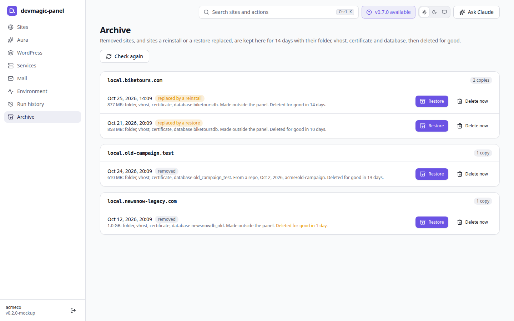
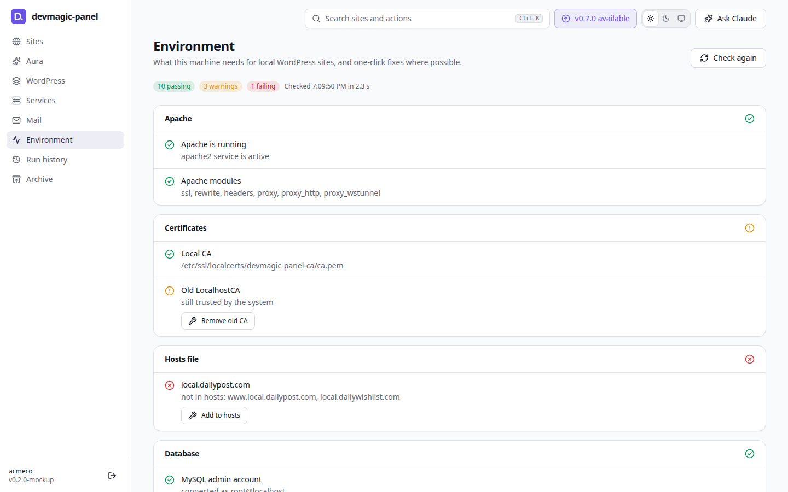
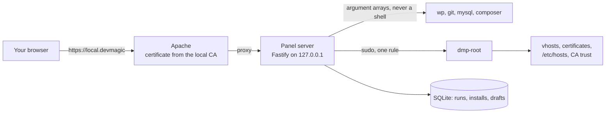

# DevMagic Panel - Local WordPress Control Panel


[](LICENSE)
[](#-requirements)
[](#-requirements)
[](https://wordpress.org)
[](https://webtimeless.cloud/docs/devmagic-panel/)

> 🚀 A modern, cPanel-like control panel for the WordPress sites on your own machine: open `https://local.devmagic`, log in, and manage certificates, Apache vhosts, `/etc/hosts`, WordPress cores and installs, in light or dark.

<div align="center">
  
</div>

DevMagic Panel grew out of the [devmagic](https://github.com/PetyoLazarov92/devmagic)
CLI: the same local setup (sites in `/var/www`, certificates from a local CA,
Apache vhosts), as pages and buttons instead of commands, and it works next to
the sites devmagic or you made by hand. It manages this machine only and
listens on localhost.

## 📋 Table of Contents

- [Features](#-features)
- [Screenshots](#-screenshots)
- [How it works](#-how-it-works)
- [Requirements](#-requirements)
- [Installation](#-installation)
- [Quick start](#-quick-start)
- [Pages](#-pages)
- [Living with your existing setup](#-living-with-your-existing-setup)
- [Install from an organization](#-install-from-an-organization)
- [AI assistant](#-ai-assistant)
- [Undo and backups](#%EF%B8%8F-undo-and-backups)
- [Updates](#-updates)
- [Uninstall](#%EF%B8%8F-uninstall)
- [How it stays safe](#-how-it-stays-safe)
- [Troubleshooting](#-troubleshooting)
- [Develop](#-develop)
- [License](#-license)
- [Support development](#-support-development)
- [Changelog](#-changelog)

## ✨ Features

- ✅ **Sites at a glance**: health, certificate, WordPress core, git branch, database, logs and how each site came here, for sites the panel made and sites you made by hand
- ✅ **New site wizard**: from a git repo and a database dump, a fresh WordPress, an empty site, or from your GitHub organization with Claude Code reading the docs; multisite and sites under a path of another site included
- ✅ **SSL from a local CA**: one certificate covers every domain of a site, trusted in the system, Chrome, Edge and Firefox
- ✅ **Apache and hosts**: vhosts with the panel's marker, and one marked block in `/etc/hosts`; what you made by hand stays as it is
- ✅ **nginx next to Apache**: both on ports 80 and 443, each on its own loopback address, set up and turned off in one click; move any site the panel made to nginx and back (one at a time or all at once, with the sites under its paths), pick the server for a new site in the wizard, its PHP through PHP-FPM, with Undo; the panel and phpMyAdmin stay on Apache
- ✅ **Shared WordPress cores** through `wpcore`: add a release, switch sites to it, remove unused ones
- ✅ **Local mode**: mail goes to Mailpit, search engines are told not to index, logins work from this computer only
- ✅ **One click**: wp-admin login, clear caches, flush rewrite rules, debug constants, `debug.log`, open in VS Code, switch branches, pull
- ✅ **Databases**: snapshots, restore, dump import streamed into a side database and swapped in at once (a .sql.gz unpacked on the way, MySQL's limits raised while it runs), search and replace on groups of tables at once that leaves out tables without the addresses, with a preview; prepare a production dump, or clean the database a site has now, without users (one administrator you pick stays, the author of every post), orders, form entries, logs or keys, export a gzipped clean copy for the team with a check for leftover emails, and put back the tables from before for 7 days; browse any database's tables, rows (filter, sort, pages), structure and indexes, read only, with PHP serialized values and JSON shown as a tree, and phpMyAdmin a click away; edit, duplicate, add and delete rows, each with Undo for 14 days and never over a change made since; an SQL runner for one statement that reads, in a code editor that suggests the database's own tables and columns (Explain, CSV, history), and that writes once you switch to Can write, after a check of what it changes, with the tables it names saved first for Undo; as a MySQL account that can change nothing; see a WordPress database as WordPress does: autoloaded options against Site Health's limit, transients, revisions, spam and orphaned meta, the biggest postmeta keys and the users, per site of a network; clean up transients, autoload, revisions, drafts, trash, spam and orphaned meta, and empty or delete a table, each saved first so Undo puts it back for 14 days
- ✅ **Cron**: your crontab's tasks from the Services page (a site's WP-Cron, WP-CLI commands, PHP files, local URLs, programs), with history and Undo, and each site's WP-Cron events on its own Cron tab; only the panel's block of your crontab is ever written
- ✅ **Aura**: every problem on your sites and this machine in one list, with one-click fixes and Fix all
- ✅ **Undo and the Archive**: removed or replaced sites are kept for 14 days, installs can be undone, and system files are backed up before any change
- ✅ **Updates without a token**: through public HTTPS, the GitHub CLI or git over SSH, whichever reaches the repository
- ✅ **Optional AI assistant**: a briefing, a chat and an MCP server for Claude Code; every change comes back as a card you run
- ✅ **Light and dark themes**, a phone-friendly layout, localhost only

[⬆️ Back to top](#-table-of-contents)

## 📸 Screenshots

<picture>
  <source media="(prefers-color-scheme: dark)" srcset="assets/screenshots/sites-dark.png">
  
</picture>

<details>
<summary><b>More screenshots</b></summary>

**Aura**: every problem in one list, with its fix

<picture>
  <source media="(prefers-color-scheme: dark)" srcset="assets/screenshots/aura-dark.png">
  
</picture>

**New site**: four ways to start, and unfinished installs to continue

<picture>
  <source media="(prefers-color-scheme: dark)" srcset="assets/screenshots/new-site-dark.png">
  
</picture>

**A site**: core, debug constants, quick actions, Local mode and uploads

<picture>
  <source media="(prefers-color-scheme: dark)" srcset="assets/screenshots/site-dark.png">
  
</picture>

**Archive**: copies by site and date, to restore or delete

<picture>
  <source media="(prefers-color-scheme: dark)" srcset="assets/screenshots/archive-dark.png">
  
</picture>

**Environment**: the checks behind it all

<picture>
  <source media="(prefers-color-scheme: dark)" srcset="assets/screenshots/environment-dark.png">
  
</picture>

</details>

The screenshots use the mockup's sample data (`npm run mockup`).

[⬆️ Back to top](#-table-of-contents)

## 🧭 How it works



- **One server, one page.** A Fastify server on `127.0.0.1` serves the React
  UI and runs a fixed list of actions. Apache puts it at
  `https://local.devmagic` with a certificate from the panel's local CA.
- **Root through one door.** Everything that needs root goes through
  `dmp-root`, a root-owned script that validates every argument and reads its
  paths from `/etc/devmagic-panel/config.env`. The sudoers rule allows only it
  and `wpcore`.
- **The system is the source of truth.** Sites, aliases and certificates are
  read from the vhosts, `/etc/hosts` and the certificate folder; the panel's
  own database keeps only what the system cannot tell, like how a site was
  installed and the wizard's answers per repo.
- **Jobs you can follow.** Installs, imports and updates run as jobs with
  steps, progress and output. A failed job can be retried from its step, and
  most can be undone.

[⬆️ Back to top](#-table-of-contents)

## 📦 Requirements

Ubuntu or Debian (Mint works), sudo rights and curl. The installer checks the
rest first and installs what is missing after asking:

| Group | What | How the installer handles it |
| --- | --- | --- |
| Required | Apache with PHP 8.1+ and the WordPress modules (through PHP-FPM on a new machine; mod_php already there stays), MySQL (MariaDB on Debian), OpenSSL, `libnss3-tools`, git, unzip, WP-CLI, Node.js 22.13+ | installed after one question; `--yes` installs them |
| Recommended | Composer, Imagick, Mailpit, PHP-FPM where mod_php runs | asked, yes by default |
| Optional | Xdebug, phpMyAdmin | asked, no by default |
| For installs from an organization | GitHub CLI, rclone, Claude Code | one question, no by default; you sign in to each |
| For GitLab groups | GitLab CLI (`glab` 1.36 or newer) | reported only: `sudo apt install glab` where apt has it (Ubuntu 24.04 and later, Debian 13), GitLab's install page elsewhere |

Without Node.js, the installer offers the official Node.js 22 build from
nodejs.org, checked against its checksums, for the panel only. The Environment
page checks the same parts later and marks each as required, recommended or
optional.

[⬆️ Back to top](#-table-of-contents)

## 💻 Installation

The panel installs from its releases: a package with the built panel, its
runtime dependencies, the root scripts and the installer, about 11 MB, built
and checked by GitHub for every version tag. Nothing is built on your machine.

Any access to the repository is enough, and no token is needed. Pick the
command that fits; `get.sh` then tries the same ways for the package itself.

### Method 1: from the releases (recommended)

```bash
# The repository is public: no login at all.
curl -fsSLO https://github.com/PetyoLazarov92/devmagic-panel/releases/latest/download/get.sh && bash get.sh --dry-run
```

```bash
# You are signed in to the GitHub CLI (gh auth login) with access to it.
gh release download -R PetyoLazarov92/devmagic-panel -p get.sh && bash get.sh --dry-run
```

```bash
# Your SSH key can read it: the pkg/latest branch holds the newest package.
git clone --depth 1 --branch pkg/latest git@github.com:PetyoLazarov92/devmagic-panel.git devmagic-panel-pkg && bash devmagic-panel-pkg/get.sh --dry-run
```

`--dry-run` shows every change first; run `bash get.sh` (or
`bash devmagic-panel-pkg/get.sh`) without it to install. `get.sh` finds the
newest release (or the one you give with `--version v0.7.0`), gets
`devmagic-panel-<version>.tar.gz` and its checksum, checks it, and runs that
release's `install.sh`. Cloned from `pkg/latest`, it installs the package next
to it with no download. A fork or a moved repository works with `--repo
owner/name`.

### Method 2: from a checkout

```bash
git clone git@github.com:PetyoLazarov92/devmagic-panel.git ~/projects/devmagic-panel
cd ~/projects/devmagic-panel
./install.sh --dry-run
./install.sh
```

Run from a git checkout, the installer builds the commit you have checked out
into a release in a temporary folder, the way GitHub does
(`npm run package`), and installs that: `v0.6.0` at a release tag,
`v0.6.0-dev.1a2b3c4` between releases. Uncommitted changes are not in it, so
commit them first. The checkout is never used by the running panel, so it can
change, switch branches or rebuild freely.

### Installer options

```bash
./install.sh                 # interactive install
./install.sh --dry-run       # print what would change, change nothing
./install.sh --yes           # install what the panel needs, skip the rest
./install.sh --skip-optional # do not offer recommended or optional components
./install.sh --uninstall     # remove the panel; add --dry-run to see what first
```

`--from-panel` is for the panel's Updates page, not for you: it updates an installed panel with the sudo password on stdin (kept only in the installer's memory, never in a file, a log or a command line), answers every question with its default, and runs as one transaction. It keeps the root scripts, `config.env` and the sudoers rule, swaps the new root scripts in whole, backs up certs, vhosts and hosts, and once the panel restarts checks it answers with the new version. When a step fails, everything is put back (the old root scripts, config.env, sudoers rule and backup, and the release before, restarted), and `~/.local/share/devmagic-panel/update-status.json` says what happened.

### What the installer does

<details>
<summary><b>Every step, in order</b></summary>

1. Reports what the panel needs, found or missing, before it changes
   anything, and installs what is missing:
   - **Required**, after one question (`--yes` installs them): Apache with PHP
     and the WordPress modules (on a new machine through PHP-FPM, with the
     panel's handler sending every site's PHP to it and Apache on mpm_event;
     a machine with mod_php keeps it until you switch on the PHP tab), MySQL (MariaDB on Debian; one already there
     stays), OpenSSL, `libnss3-tools`, curl, git, unzip, WP-CLI and Node.js
     22.13+. Without Node, it offers the official Node.js 22 build from
     nodejs.org, checked against its checksums, in
     `~/.local/share/devmagic-panel/node` for the panel only, so switching
     nvm versions never breaks the panel. No to a required part stops the
     install and prints the apt command.
   - **Recommended**, asked with yes as the default: Composer, Imagick,
     Mailpit (the panel's own copy, as on the Services page) and, where mod_php
     runs, PHP-FPM so a site can have its own PHP.
   - **Optional**, asked with no as the default: Xdebug, phpMyAdmin and
     nginx. nginx is installed in an apt-get of its own once Apache holds
     port 80 (so the package leaves it stopped), then set up next to Apache
     (step 10). An nginx already installed is offered the setup only.
   - **For installs from an organization**, one question, no by default: the
     GitHub CLI, rclone and Claude Code. Signing in to them stays yours; the
     installer prints how. The GitLab CLI, needed only for GitLab groups, is
     reported with where to get it and never installed in that group.
   - It warns about PHP older than 8.1, and with `--yes` about an nginx that
     is installed but not set up. `--yes` and `--skip-optional` skip all but
     the required parts.
2. Writes `/etc/devmagic-panel/config.env` with the detected paths.
3. Puts the release in `~/.local/share/devmagic-panel/releases/<version>`: as
   it is, or built from the checkout.
4. Installs the root scripts (from that release) to
   `/usr/local/lib/devmagic-panel` and a sudoers rule that allows only
   `dmp-root` and `wpcore` without a password.
5. **Backs up** `/etc/ssl/localcerts`, the Apache vhosts, nginx's sites when
   nginx is installed, `/etc/hosts` and the system CA folder to `~/devmagic-panel-backups/` (readable only by you; it
   holds private keys).
6. Enables the Apache modules it needs (`ssl`, `rewrite`, `headers`, `proxy`,
   `proxy_http`, `proxy_wstunnel`).
7. Creates a new local CA and trusts it in the system, Chrome, Edge and
   Firefox (Chrome and Edge share one store).
8. Offers to reissue the certs of existing sites from the new CA, covering
   every name in each vhost. The old devmagic `LocalhostCA` stays trusted until
   you remove it from the Environment page.
9. Sets up `https://local.devmagic` and asks for a panel password and your
   MySQL admin account. When no account you have signs in (on a new MySQL or
   MariaDB, root signs in only through sudo), it can make one for the panel,
   `devmagic_panel@localhost`, with `sudo mysql` and a generated password
   kept only in the panel's secrets file. Then it points
   `~/.local/share/devmagic-panel/current` at the release and starts a systemd
   user service that runs whatever `current` points at. The release before
   stays for switching back (the newest three stay), and a v0.5 install's
   clone in `~/.local/share/devmagic-panel/app` goes. It offers to keep the
   service running after you log out (`loginctl enable-linger`), so a running
   install or import is not cut off.
10. Sets nginx up next to Apache when you said yes to it (`dmp-root
    nginx-setup`): Apache's `ports.conf` moves from every address to
    `127.0.0.1` (the original is kept in `/var/lib/devmagic-panel/nginx`),
    Debian's default nginx site goes off, the panel's settings go in
    `/etc/nginx/conf.d/devmagic-panel.conf`, and nginx answers on `127.0.0.2`.
    Once nginx is set up, every later run writes those settings again.
11. Installs Mailpit when you said yes to it. On a home folder encrypted with
    eCryptfs, which unlocks only when you log in, systemd cannot start your user
    services at boot or login, so it also writes
    `~/.config/autostart/devmagic-panel.desktop`: your desktop then starts the
    panel and Mailpit once you log in. The Environment page checks for it and
    adds it in one click.
12. Writes the list of everything it put on the machine to
    `/var/lib/devmagic-panel/installed-files` (root-owned, readable by all):
    each path, what it is, and whether an uninstall removes it, asks, or keeps it.

</details>

Run it again any time, as `~/.local/share/devmagic-panel/current/install.sh`;
it skips what is already done. Restart your browsers after the first install
so they load the new CA.

Every run is logged to `~/.local/state/devmagic-panel/logs/install-<date>.log`
(the newest 20 stay). Passwords never reach the log: sudo asks on the terminal
itself, and the panel's own questions run outside it.

[⬆️ Back to top](#-table-of-contents)

## 🚀 Quick start

1. Open `https://local.devmagic` and log in with the panel password you set
   during the install. The login page greets you by your computer account,
   warns when Caps Lock is on, counts down after too many wrong tries, and
   says when this browser last signed in (kept in the browser only).
2. **Sites** lists every site on this machine, the ones you made by hand
   included. **Aura** shows what needs attention, with a fix for most of it.
3. **New site** walks you through a site from a repo and a dump, a fresh
   WordPress, an empty site, or one from your organization. Each step shows
   its output, and you can leave and come back while it runs.

Change the panel password from the key button next to Log out, or on
Environment → Settings: it asks for the current one, and every other browser
is signed out. Forgot it? **Forgot your password?** on the login page resets it
with the password you log in to this computer with (sudo checks it; the panel
never keeps it, and 5 wrong tries lock it for an hour), or set one in a
terminal:

```bash
node ~/.local/share/devmagic-panel/current/server/dist/cli.js set-password
```

New passwords need 8 characters or more, with no rules about capitals or
symbols; the most common passwords and your user name with digits are refused.

When the installer put Node.js in place for the panel, use
`~/.local/share/devmagic-panel/node/current/bin/node` instead of `node`.
`setup` asks for the password and the MySQL admin account again.

[⬆️ Back to top](#-table-of-contents)

## 🧩 Pages

| Page | What it does |
| --- | --- |
| Aura | The health of your sites and this machine, every problem in one list: certs missing names, expiring or from the old CA, missing or leftover hosts lines, names served on port 80 or 443 only, insecure or outdated WordPress (from WordPress.org), Local mode off, Mailpit down, nearly empty uploads with nothing loading them from production, a wp-content WordPress cannot write to; one-click fixes and Fix all |
| WordPress | The shared wpcore cores with their WordPress.org status and the sites on each; add a release (one with known security issues after a typed confirmation, for testing), switch sites to a safe core, remove unused cores |
| Services | Six tabs, each with its own address. Overview (`/services`): a card per service (Apache, PHP, nginx, MySQL, Mailpit, Cron) with its state, its facts, its buttons (Apache reload and restart after a configtest, MySQL restart, Mailpit installed or started in one click: a pinned release, checksum checked, as a user service) and a link to its tab. PHP (`/services/php`, a version at `/services/php/<version>`): PHP on this machine first, with a tile per installed version, then everything of the version picked, one section under the other: every installed PHP version with its release and any newer build apt offers (Update in one click), versions apt can install (Install, with PHP-FPM, the command line and the common modules; the one-time command for the ondrej/php PPA when apt has no other version) and Remove for one nothing uses, module packages from apt per version, the parts installed (mod_php, PHP-FPM, command line), its modules and Xdebug (any mix of modes) switched per version, every site's code checked against the version with a table of what each has (Sites), the panel's own settings per version for the web and the command line (memory, uploads, time limits, errors, OPcache and more, in its own 99-devmagic-panel.ini; php.ini is never edited), what each php.ini changes from the packaged one with a job that moves those changes into the panel's settings, PHP info and Xdebug info for the web and the command line (asked from PHP itself, password-like settings hidden), a check of what changes for sites on PHP-FPM, Make PHP-FPM match Apache for a version whose FPM differs from its mod_php, and How sites run: the switch that turns mod_php off and runs every site on one version through PHP-FPM (Apache on mpm_event, phpMyAdmin in a pool of its own, every site checked afterwards, Undo turns mod_php back on), and the way back. MySQL (`/services/mysql`, a database at `/services/mysql?db=<name>`): every database and user with what each is to the panel, each database a link to its tables and an SQL runner (a site's open on the site's Database tab), Processes with Stop for a statement MySQL runs (a site's, kept for a site, not used by a site, left behind, MySQL's own), fresh sizes, Analyze and Optimize, delete a database or user no site uses (saved first to the panel's MySQL backups for 14 days, so Undo puts it back; Saved copies lists them, with Delete to remove one sooner), reset a site's database user. Apache (`/services/apache`): Apache at a glance (state and uptime, version, worker model, PHP, ports), every module in mods-available with a switch (the panel's own, the core ones, php* and mpm_* stay as they are; a change whose configtest fails is taken back), every vhost file with whether it is enabled and whose it is, a configtest and Apache's own error log. nginx (`/services/nginx`): nginx next to Apache, both on ports 80 and 443, each on its own loopback address (Apache on `127.0.0.1`, nginx on `127.0.0.2`), so a site goes to the server its hosts line points at with nothing proxied; the command to install it, Set up nginx (Apache restarts on its address, Debian's default nginx site goes off, every site is checked afterwards, Undo turns nginx off), Write settings again and Turn nginx off, nginx -t and Reload, every config in sites-available with whether it is enabled, whose it is and whether it takes Apache's ports, and nginx's own error log. Once nginx is set up, a Sites card shows how many sites run on each server, sets the web server the new site wizard picks, and moves every site to nginx or to Apache in one job (each site checked as it moves, the ones that stay listed with why, Undo moves them all back). Cron (`/services/cron`): the panel's tasks in your crontab (a site's WP-Cron, a WP-CLI command, a PHP file in a site, a local URL, or a program with arguments, run without a shell) with a schedule in words and its next runs, a time limit, a switch, Run now and a history of runs with their output; the lines you wrote yourself, read only; and system cron and the systemd timers, read only |
| Mail | The mail your local sites sent, caught by Mailpit: all sites or one, HTML shown in a sandbox, delete a site's mail; installs Mailpit in one click when it is missing |
| Environment | Checks the panel's own installation (files, root scripts, build), Apache, nginx once it is installed (set up, running, nginx -t, each server on its own address, configs made by hand that take Apache's ports), certificates, hosts entries, MySQL, PHP, tools and access, each marked required, recommended or optional, with one-click fixes; groups that all pass start closed. Its Settings tab (`/environment/settings`) holds the AI assistant and the Claude Code defaults for organization installs |
| Sites | Each site's tabs have their own address (`?tab=database`, `?tab=logs&log=apache`), so a reload or a link opens the same one. They come in a fixed order: Overview and Logs, then WordPress and its data (Network on a multisite, Plugins, Database, Cron, Config), then the server (PHP, Domains and SSL), and a tab's badge counts only what needs a look: errors in debug.log, late WP-Cron events, local constants to set, names the certificate or hosts file leaves out. Overview has a tile for each other tab (debug mode, the network, the database, WP-Cron, PHP, domains and the certificate) that opens it, then git (one section per repo: the site's own, wp-content, each theme, plugin and must-use plugin folder with a `.git` of its own, and mounted folders, each with its branch, pull, fetch, switch and pull or merge requests), quick actions and the core; the debug constants sit on the Logs tab above debug.log. Domains and SSL starts with the Web server card: the server the site runs on and Move to nginx or Move to Apache (a job: the other server's config, the hosts line, a check the site answers, then the old config goes; Undo moves it back), with the `.htaccess` rules nginx would leave out to tick first, and why a site stays on Apache when it must. A WordPress site's Cron tab lists its WP-Cron events with Run now and Delete (Undo puts one back), its intervals, Check WP-Cron, its cron tasks, and the switch that runs its WP-Cron from cron instead of page loads. Your local sites with health, certs, core, git, database, multisite, logs and how each was installed (by the panel and from what, restored, or by hand), with a filter for it. A WordPress install a vhost serves under a path (an `Alias`, like Northwind Learn at `local.northwind.com/learn`) is a site of its own (the wizard installs one too: its own folder, an Alias in the parent's vhost), with its own folder, database, git, debug settings, logs, Local mode and snapshots; its vhost, certificate and hosts line stay with the parent. Also: one-click wp-admin login (Network Admin too), a network's sites with archived, spam, hidden and deleted ones marked and filtered, a super admin made administrator on every site of a network (Undo on the job takes it back), clear caches, flush rewrite rules, each debug constant on its own (WP_DEBUG, WP_DEBUG_LOG, WP_DEBUG_DISPLAY, SCRIPT_DEBUG, SAVEQUERIES), clear debug.log, a PHP tab with the site's own PHP version and settings through its own PHP-FPM pool (checked against what its composer.json, plugins and themes ask for; WP-CLI the panel runs for it follows; after a switch the panel opens the home page and wp-admin and reads the site's logs for new PHP fatal errors; Undo on the job puts it back), a compatibility check of its themes and plugins against another PHP version before you switch (PHPCompatibilityWP, fetched once with Composer into the panel's data folder; a hint that never blocks the switch), PHP info from the PHP that serves it, a Plugins tab that turns each plugin on or off with one switch (search, filters, updates WordPress already found, what each needs and what needs it, the plugins turned off at install and the local helpers marked, Undo in the toast), open in VS Code in a new window, open a terminal at the site's folder (the desktop's default terminal, when the panel runs in your desktop session), switch the shared WordPress core, switch git branches (search by any letters of the name), each branch's open pull request on GitHub (through the GitHub CLI when you are signed in to it), pull and fetch (mounted folders too), the Database tab's Tables (every table with its engine, rows and size; a table's rows a page at a time, sorted and filtered (every filter, or any of them), a row with all its values in full and PHP serialized values or JSON as a tree; Edit, Duplicate, Add a row to the table and Delete, also on rows ticked together, each with Undo for 14 days and only while the row still holds what you saw, with broken PHP serialized lengths flagged and fixed; its columns, indexes and CREATE TABLE; Open in phpMyAdmin), WordPress (autoloaded options against Site Health's 800 KB limit with Turn off for a big one, transients with Delete expired and Delete all, what a clean-up would find with a tick each and Delete the ticked, the postmeta keys that take the most room, the users with their roles, for each site of a network; each clean-up saves what it removes first and lists it under Changes you can undo), SQL (one statement that reads, as the read-only MySQL account, in an editor with MySQL's keywords coloured and the database's tables and columns suggested, Tab to take one: up to 1,000 rows, Explain, CSV, the last 30 statements in this browser; Can write runs one statement that changes rows or a table after Check and run shows the rows it changes and the tables it saves first, Undo for 14 days) and Backups and tools (database snapshots, restore, dump import and search and replace with a preview), Local mode with blocked hosts, where missing uploads load from, fix health issues in one click, move sites to the Archive (any site in the usual layout) |
| New site | Paste a repo URL and pick one of its real branches (the default one first); the wizard fills itself from your last install of that repo (the panel remembers its answers; nothing is written into the repo). From a git repo and a database dump, a fresh WordPress, an empty site, or from an organization. One cert, vhost and hosts line cover every domain; the addresses the dump uses (production, staging, another local copy, with a port or not) are replaced, a network's sites listed by name with a choice of its type here, subdirectory or subdomain in WordPress's words (it starts as the dump has it, sets SUBDOMAIN_INSTALL to match, is remembered per repo, and the install moves the sites whose address changes after the replace; a network is never installed under a path, and one served through a domain mapping plugin keeps its domains), production-only plugins deactivated (a search finds one in a long list), the local helpers the repo has (as a plugin folder or in composer.json) turned on, missing images loaded from the production domain you give. A build checklist lists every composer.json and package.json in the repo and ticks only the ones whose output the repo does not hold (vendor/ or a build folder git ignores; never a wordpress.org plugin), with their build, prod or production script; watchers are never offered. The newest core you have is picked unless you choose another. A dump's admins are listed (a network's super admins; the scan reads up to 16 GB of SQL for them), one-click login signs you in as the first, and an admin for this copy (admin / admin, superadmin on a network) is made only when you switch it on, or when the dump has none. Domains are replaced in URLs only. Each step shows its output and progress (clone, import, replace), the header lists running installs so you can leave and come back, at most two run at once, and free disk space is checked first; a failed install can be retried from its step or undone, and a failed step the site works without (the build, the local helpers, BE Media, `.htaccess`, flushing caches, the admin account) can be skipped: the install goes on and the site's page keeps what is left to do, each with a Done button once you did it yourself. Builds run with the Node the repo's `.nvmrc` or `.node-version` asks for, from nvm, else nvm's default or the Node the panel runs on, since the panel's service has no nvm in its PATH. Go back a step and the steps you reached stay open until you change an answer; put it back and they open again |
| Run history | Every action the panel ran, with its result, in numbered pages; an install that went on without a step shows a warning and how many it skipped, as on the Jobs page; kept 90 days (at most 2000 runs) |
| Archive | Copies of sites from the last 14 days, by site and date: removed, or replaced by a reinstall or a restore, each with its folder, vhost, certificate and database. Restore one (over the current site after it is archived too), or delete it for good |

[⬆️ Back to top](#-table-of-contents)

## 🤝 Living with your existing setup

- **Vhosts stay as they are.** The panel only rewrites or removes a vhost
  whose first line is its own marker. Sites made by hand or by devmagic keep
  their vhost; the panel reissues their cert and manages their hosts line.
- **nginx runs next to Apache, never in its place.** Once you set it up,
  Apache answers on `127.0.0.1` and nginx on `127.0.0.2`, both on ports 80
  and 443, so other devices on your network no longer reach Apache. A site
  goes to the server its hosts line points at; the panel and phpMyAdmin stay
  on Apache. A site you move to nginx gets
  `/etc/nginx/sites-available/<domain>.conf` with the panel's marker and its
  PHP through PHP-FPM; nginx reads no `.htaccess`. Sites under its paths go
  along, each from its own folder with its own PHP. Vhosts made by hand and
  names in hosts lines outside the panel's block keep their sites on Apache. nginx configs you wrote stay
  as they are; one that listens on port 80 or 443 on every address keeps
  nginx from starting next to Apache, so the setup names it and waits until
  it listens on `127.0.0.2` or is off. Turning nginx off puts Apache's
  `ports.conf` and Debian's default site back and stops nginx.
- **Hosts entries go in one marked block** in `/etc/hosts`, between
  `# BEGIN devmagic-panel` and `# END devmagic-panel`, one line per site.
  Everything outside the block is left alone.
- **wpcore is shared.** The panel uses the same `/etc/wpcore.conf` and cores
  folder as the `wpcore` command, so a core added from either side shows up in
  both.
- **One-click wp-admin login** adds one small file to each site you use it on,
  `wp-content/mu-plugins/devmagic-panel-login.php`. It is excluded from git in
  the repo's local `.git/info/exclude`, so it never shows up in `git status` or
  gets committed, and it only accepts one-time links the panel makes for 60
  seconds on local domains.
- **`.htaccess`** is written only when a site has none (new installs, or the
  Aura fix), with WordPress's own rules for a single site or a network, and
  kept out of git locally. An `.htaccess` your repo tracks is never changed.
- **Local mode** is a second small file, `wp-content/mu-plugins/devmagic-panel-local.php`,
  excluded from git the same way. New sites get it; existing sites get it when
  you turn it on (site page or Aura). It sends all mail to Mailpit
  (`127.0.0.1:1025`), tagged with the site so the Mail page can show it, tells
  search engines not to index, shows a Local label after the site name in the
  admin bar, accepts logins only from this computer (Apache answers on every
  network address, so a simple local password must not work from another
  machine), blocks requests to mail APIs and any hosts you add, lets wp-admin
  install and update plugins without FTP details (`FS_METHOD` direct), on a
  network makes a long My Sites menu fit the window and scroll, with a filter
  once it lists 10 sites, and, for vhosts made by hand, sends missing uploads to
  production. It does nothing
  when the site's address is not a local name.
- **Your crontab keeps its lines.** The panel's cron tasks live in one marked
  block, between `# BEGIN devmagic-panel` and `# END devmagic-panel`, and the
  panel changes only those. Lines you wrote with `crontab -e` are shown and
  left as they are. A site's WP-Cron runs from page loads as before until you
  switch it to cron on its Cron tab.
- **Removing a site** works for any site in the usual layout
  (`/var/www/<domain>` with a `<domain>-ssl.conf` vhost), made by the panel or
  not. It exports the database, archives the folder, vhost, certificate and
  dump into the Archive, and only then removes them and drops the database
  (and the site's own database user). Archived copies can be restored for 14
  days; then they are purged. Hosts lines outside the panel's block stay as
  they are.
- **Reinstalling or restoring over a site** archives the current one the same
  way first, after you confirm, so nothing is lost: the wizard warns when the
  domain is installed already, and a restore asks when the site exists again.
  Undo on the job puts the current site back.
- **Install drafts**: the new site wizard saves its answers (never a password)
  as you go, from the moment you continue from Start. Each draft has its own
  address (`/sites/new/<draft>/<step>`), so the browser's Back and Forward
  move between its steps and a link opens it again. Unfinished installs are
  listed on the Sites page, to continue or discard, for 24
  hours after the last change; while an install runs its draft stays, and once
  the site is in place the draft and its dump go.

[⬆️ Back to top](#-table-of-contents)

## 🏢 Install from an organization

Optional. The new site wizard's first start, **From an organization or
group**, opens
once Claude Code is installed and signed in (`claude auth login`); until then
the card says what is missing. Sign in with your claude.ai account, with
Asana, Google Drive and Google Docs connected there, and the card gets an
animated border: that sign-in is what reaches the linked tasks and files.

1. **Organization or group**: the GitHub CLI (`gh auth login`, its own browser
   sign-in) lists the GitHub organizations you belong to, and the GitLab CLI
   (`glab auth login`, `--hostname gitlab.acme.test` for your own GitLab) the
   GitLab groups you can clone from, on gitlab.com and on the hosts you add
   under Your own GitLab hosts; tick the ones to scan. A GitLab group is
   scanned with its subgroups, so only the top group you belong to is offered,
   and a project shows with its path in the group (`clients/site`). Your own
   account on each host is listed too, ticked for you once per host, the first
   time that host's CLI is signed in, and **Shared with you** lists the repos you were added to outside
   those: GitHub repos you collaborate on, GitLab projects outside your groups.
   The panel only runs `gh` and `glab`; it never reads their tokens. Their repos
   show what each holds (WordPress site, theme, plugin) and whether this
   machine has it installed, archived or as an unfinished install. The list
   is kept in the panel's database and shows at once; opening the page checks
   for new pushes when the last check is over an hour old (usually one page
   of GitHub's REST API), and once a week, or with Rescan all, every repo is
   listed again so deleted and renamed ones go. A repo is looked into again
   only after a push (on GitLab, after any activity; checks read 70 minutes
   back, as GitLab moves that time about once an hour). Your installed sites
   need none of this: their Git card reads the site's own `.git` and the repos
   inside it (wp-content, themes, plugins), whatever the host, and a host whose name does not say what it runs (`git.acme.test`, or
   an SSH alias like `gitlab-work`) is found once a week with `ssh -G` and the
   same SSH hello `git fetch` makes, so its links and merge requests are right
   without a setting. Without the CLI the
   last list still shows and installs, as cloning uses git, or you paste a
   repo URL from any git host.
2. **Read the repo**: Claude Code reads only the repo's docs and build files
   (README, `docs/`, `composer.json`, local dev configs; never `wp-config.php`
   or `.env`), copied into a folder of their own, and fills a fixed form,
   mostly to find where the database dumps are: the Asana and Google links
   and what the docs say about dumps, plus versions, build and the production
   address. Each answer names the file it came from. Then it says that the
   next step checks your access to those links.
3. **Links and dump**: Claude Code opens each link read-only and marks it ok,
   no access or not found, collects facts for the install, and lists the
   database dumps in Google Drive by name, size and date only. Pick one: rclone
   downloads it (with a free space check), or you download it in the browser
   and pick it from your Downloads folder, or upload it.
4. The usual steps follow, filled in. The dump is the source of truth, as in
   an install from a git repo and a dump: the domains, the network and its
   sites come from it, and its "Found in the dump" card shows what it holds.
   The docs' production address is only offered for missing images when the
   dump is already a local copy. Your local setup wins over the docs
   (local.* names, wpcore, the cores you have, Apache), the differences are
   listed, and what nothing answered stays empty for you. The site shows "From
   an organization" on the Sites page.

Steps 2 and 3 run as jobs: leave the page and they keep going, show in the
jobs list, and the wizard picks up their answer when you come back. A card
beside them sets the model, effort and spending cap for the next Claude
Code step of that install. The defaults per step live under Environment,
Settings (Read the repo: Sonnet, medium effort; Links and dump: Sonnet, low
effort; $0.50 per run), with Check connectors to see that Asana and Google
are reachable. Runs have only read-only tools. The panel stores no token for any of this:
Claude Code, `gh` and rclone keep their own sign-ins, and the panel runs them
as you without reading them. The Environment page shows whether each is set
up and signed in.

[⬆️ Back to top](#-table-of-contents)

## 🤖 AI assistant

Optional and off by default; every page works without it. Turn it on under
**AI assistant** under Environment, Settings, pick a model and save your own
Anthropic API key (or rely on `ANTHROPIC_API_KEY` or `ant auth login`). With it
on, the Sites page opens with a short briefing from Claude on what needs
attention, each point with the panel's own fix buttons, and **Ask Claude** in
the header opens a chat. Claude reads the panel's own data (sites, findings,
logs, repo docs, git, services, a site's database as names, sizes and counts)
and shows what it looked at; anything it wants
to change comes back as a card you run yourself. Tool results have anything
secret-looking blanked out, database contents are never sent, and the
assistant can never change its own settings.

On the new site wizard, **Describe the site to Claude** fills in every step
from your words, the repo, the dump and `conventions.md` (how sites are set up
here, editable under AI assistant and meant to be shared with your team). You
review each step and install as usual.

**From Claude Code or Claude Desktop:** the panel is also an MCP server. Copy
the `claude mcp add` command from the AI assistant card and run it once. Claude
Code then reads your sites with the same tools, and anything it wants to
change shows up as a card in the panel that you run yourself. This needs no
API key and works with the assistant off.

[⬆️ Back to top](#-table-of-contents)

## ↩️ Undo and backups

The installer backs up certs, vhosts, nginx's sites, `/etc/hosts` and the
system CA folder to `~/devmagic-panel-backups/` before it changes anything. Make another backup
any time with `sudo /usr/local/lib/devmagic-panel/bin/dmp-root backup`. To go
back:

```bash
sudo /usr/local/lib/devmagic-panel/bin/dmp-restore --list
sudo /usr/local/lib/devmagic-panel/bin/dmp-restore          # newest backup
sudo /usr/local/lib/devmagic-panel/bin/dmp-restore <file>   # a given one
```

It asks for your password on purpose: restoring writes Apache and nginx
config, so it is not part of the passwordless rule. While nginx runs next to
Apache, a backup from before keeps Debian's default nginx site off. It backs up the current state first, so
a restore can be undone too. If the panel's own site is gone afterwards, run
`~/.local/share/devmagic-panel/current/install.sh` again.

Inside the panel, installs and most jobs have **Undo**, and removed or
replaced sites wait in the **Archive** for 14 days. A change to your crontab
saves it to `~/devmagic-panel-backups/` first, and so does a deleted WP-Cron
event; the notice's Undo puts it back. A row changed, added or deleted on the
Database tab is saved to `~/devmagic-panel-backups/row-changes/` (readable only
by you, 14 days) before it changes; Undo is in the notice and under Changes you
can undo, and only puts it back while the row still holds what the change left.
A clean-up (transients, revisions, spam, meta left behind) or an emptied or
deleted table saves what it removes to `~/devmagic-panel-backups/cleanups/`
first (readable only by you, 14 days); Undo is on its job and under Changes
you can undo, and leaves a row made again since as it is. SQL that writes
saves the tables it names the same way, and its Undo puts them back as they
were before it.

[⬆️ Back to top](#-table-of-contents)

## 🔄 Updates

The release workflow builds and checks a package from each version tag
(`v0.7.0`) and publishes it twice: as a GitHub release, and as the package tag
`pkg/v0.7.0` (with the `pkg/latest` branch) for git. The panel reads them at
start and every six hours through the first way that can reach the
repository: public HTTPS when it is public, the GitHub CLI when it is signed
in, or git over SSH when your key can read it. It needs no token, keeps the
way that worked for next time, and the Updates page shows which one it used
and why the others did not work. The header shows "v0.7.0 available" (only its
icon on a phone), or "No access to updates" when no way works. The Updates
page lists what is new from the release notes of every version since yours,
right under the update: the newest open, the ones before it closed. And:

- **updates from the panel**, after you confirm, when the release keeps the
  installed root scripts: it downloads the package (about 11 MB), checks its
  checksum, unpacks it in `~/.local/share/devmagic-panel/releases` next to the
  running one, points `current` at it and restarts. Nothing is built. The run
  is logged to `~/.local/state/devmagic-panel/logs/update-<date>.log`. When the
  release changes `install.sh` too, the panel still updates itself and says to
  run `~/.local/share/devmagic-panel/current/install.sh` afterwards for the
  installer's part.
- **downloads it, then installs it with your sudo password** when the release
  changes the root scripts (`scripts/`: `dmp-root`, its libraries, `wpcore`),
  which only its own `install.sh` may put in place. You type the password into
  a field on the Updates page; it goes once to the release's
  `install.sh --from-panel` (on its stdin, through a FIFO systemd opens for it,
  never on a command line or in a file), and the panel never saves it. The
  installer runs in a background unit of its own, keeps the root scripts,
  `config.env` and the sudoers rule, swaps the new root scripts in whole,
  restarts the panel and checks it answers with the new version. When a step
  fails, it puts everything back and the page says what happened; an install
  interrupted by a reboot can run again. The same command still works in a
  terminal: `~/.local/share/devmagic-panel/releases/<version>/install.sh`.
  Without your password nothing can replace root code: the passwordless sudo
  rule only covers `dmp-root` and `wpcore`, never their replacement.

Installed releases lists what the releases folder keeps: the running release
and the newest others, three in all. **Switch to it** points `current` at one
and restarts, to go back after an update. One with other root scripts than the
installed ones switches through its own `install.sh` with your sudo password,
or in a terminal when its installer is older than v0.25.0.

`UPDATE_REPO` (owner/name) and `UPDATE_GIT_URL` in `/etc/devmagic-panel/config.env`
point the panel at another repository, like a fork. A panel that runs from a
checkout (`npm run dev:server`) does not update itself. Panels before v0.7.0
saved a GitHub token; v0.7.0 deletes it, and the Updates page says to revoke
it on GitHub too.

[⬆️ Back to top](#-table-of-contents)

## 🗑️ Uninstall

```bash
~/.local/share/devmagic-panel/current/install.sh --uninstall --dry-run   # see what goes and what stays
~/.local/share/devmagic-panel/current/install.sh --uninstall
```

`./install.sh --uninstall` in a checkout does the same. It works from the
installer's list of what it put on the machine (or the usual list for installs
older than v0.5.0). It stops the panel and Mailpit, turns nginx off when the
panel set it up next to Apache (every site on nginx back to Apache first,
then Apache back on every address, nginx stopped and left installed),
removes the panel's own
site (`local.devmagic`: vhost, certificate, hosts line), the releases and
`current` (and a v0.5 clone in `app`), the Node.js it installed for the panel,
the systemd unit, the login entry on an encrypted home, the panel's block in
your crontab (your own lines stay), the root scripts, the sudoers rule and
`config.env`. Before
removing anything it asks about the rest:

| Asked | Default |
|---|---|
| The backups in `~/devmagic-panel-backups` | keep |
| `/var/lib/devmagic-panel`: archived sites you can still restore, and the registry | keep |
| The panel's data: settings, saved password, MySQL account, run history, uploads, Mailpit | remove |
| The install logs | remove |
| Lingering, when the installer turned it on | keep |
| Local mode and the login helper in your sites (without Local mode a site can email real people) | keep |
| The panel's local CA and its trust in the system and your browsers | remove when no site certificate is signed with it; keep when one is |

For the CA it checks every certificate in `/etc/ssl/localcerts` and lists the
sites signed with the panel's CA: removing it would break https for them until
their certificates are reissued, so then it stays unless you say otherwise, and
the uninstaller prints how to remove it by hand later. Certificates from
another CA, like devmagic's `LocalhostCA`, and that CA itself, are never
touched. Neither are your sites, their databases and certificates, the wpcore
cores and `/etc/wpcore.conf`, the packages it installed (WP-CLI, Apache, PHP,
MySQL and the rest), a MySQL account it made for the panel, and a `wpcore`
command of your own. A checkout you installed from stays too. `--yes` takes
the defaults without asking.

[⬆️ Back to top](#-table-of-contents)

## 🔒 How it stays safe

- The server binds `127.0.0.1`, refuses unknown `Host` headers and
  cross-origin requests, and needs a login.
- Nothing runs through a shell. Root work goes only through `dmp-root`, which
  validates every argument and takes every path from the root-owned config.
- Only local names are accepted (`local.*`, `www.local.*`, `*.test`,
  `*.localhost`), so the passwordless rule cannot mint trusted certs for real
  domains.
- Secrets live in `~/.config/devmagic-panel/secrets.json` (0600); the panel
  password is stored as a scrypt hash, and changing it signs every other
  browser out. A reset with the computer password only shows where sudo asks
  this account for one (so it proves who you are), checks it with `sudo -v` on
  stdin, and locks for an hour after 5 failures from anywhere. The SQL runner
  reads as `devmagic_panel_ro`, an account with SELECT and SHOW VIEW only, in a
  read-only transaction with a time limit; SQL that writes is a job you
  switch to, that saves the tables it names first. Passwords go to MySQL and WP-CLI
  through the environment or stdin, never the command line. Updates need no
  GitHub token: the GitHub CLI and git keep their own sign-in, and the panel
  never reads it. The same goes for the GitLab CLI, which lists GitLab groups
  and merge requests.
- Updates are packages GitHub built from a version tag, checked against their
  `.sha256` before anything is unpacked, whichever way they arrive. The
  Node.js the installer may download is checked against nodejs.org's
  checksums the same way.

[⬆️ Back to top](#-table-of-contents)

## ❓ Troubleshooting

**The browser says the certificate is not trusted.** Close and reopen the
browser once after the first install, so it loads the new CA. The Environment
page's Certificates group shows whether the system and each browser store
trust it; running `~/.local/share/devmagic-panel/current/install.sh` again adds
it to browser profiles made since.

**`https://local.devmagic` does not open.** Check the panel's service and its
log, then Apache:

```bash
systemctl --user status devmagic-panel
journalctl --user -u devmagic-panel -n 50
sudo apache2ctl configtest
```

**The panel says "Waiting for the panel to start".** Its service starts after
you log in, so a tab the browser restores right then waits for it and opens
the panel by itself once it answers. If it keeps waiting, check the service as
above, or start it with `systemctl --user start devmagic-panel`.

**Another web server holds ports 80 and 443.** The installer warns when nginx
is installed. Stop the other server or move it to other ports, then restart
Apache from the Services page; the Environment page checks that both ports
answer.

**MySQL admin account: not configured or cannot connect.** Run `setup` again
(see [Quick start](#-quick-start)). On a new MySQL or MariaDB, root signs in
only through sudo; answer `c` to make the panel's own account with
`sudo mysql`.

**Local sites send no mail.** Local mode sends it to Mailpit. Install or start
Mailpit on the Services or Mail page, then read it on the Mail page.

**The installer stops at `apt-get update`.** apt fails as a whole when any
one package source on the machine fails, often one another app added (an
editor, a browser). The installer names that source, the file it is in and
why, and when its key is on the machine already, the `signed-by=` that points
the source at it. Fix that source, or move its file out of
`/etc/apt/sources.list.d` for now, then run the installer again.

**An update says to run `install.sh` in a terminal.** That release changes the
root scripts, which only its installer may put in place with your password.
Run the command the Updates page shows.

**Where are the logs?** Installs and updates log to
`~/.local/state/devmagic-panel/logs/`; every action the panel ran is in Run
history; the Developer options page shows the service's startup log.

[⬆️ Back to top](#-table-of-contents)

## 👨‍💻 Develop

```bash
npm install
npm run dev:server   # API on 127.0.0.1:4710
npm run dev:web      # UI on http://127.0.0.1:5173
npm run mockup       # UI on sample data, no server needed
npm run typecheck && npm test && npm run test:scripts && npm run lint:scripts
npm run build && npm run package   # a release package in dist/, as GitHub builds it
```

Conventions for people and AI agents are in [AGENTS.md](AGENTS.md) and
`.cursor/rules/`.

**Developer options:** tap the version at the bottom of the menu seven times,
like a phone's build number. A Developer page joins the menu with the panel's
version and commit, its services, `config.env`, the install logs, the panel
service's startup log (starts, stops, warnings and errors, without the request
lines), every file the installer put on the machine and the files the panel
makes as it runs, as folders that start closed: open one and the panel reads
what it holds (names and sizes, never contents, at most 200 entries, and only
the folders those two lists name). A switch on that page turns it off again.
It is remembered per browser.

[⬆️ Back to top](#-table-of-contents)

## 📜 License

[](LICENSE)

DevMagic Panel is released under the [MIT License](LICENSE).

## ☕ Support development

If DevMagic Panel saves you time with your local sites, consider supporting
its development:

<a href="https://www.buymeacoffee.com/plazarov" target="_blank">
  
</a>

Every coffee goes toward:

- 🚀 New features
- 🐞 Bug fixes
- 📖 Better documentation
- 🧪 More tests
- 🔧 Keeping up with WordPress, PHP and Node.js

Found a bug or have an idea? [Open an issue](https://github.com/PetyoLazarov92/devmagic-panel/issues).

## 📝 Changelog

Every version's changes are in [CHANGELOG.md](CHANGELOG.md) and in its GitHub
release notes, which the panel's Updates page shows as what is new.

---

<div align="center">

**Made with 💚 for WordPress development**

[](https://wordpress.org)
[](https://github.com/PetyoLazarov92/devmagic)
[](https://webtimeless.cloud/)

</div>
